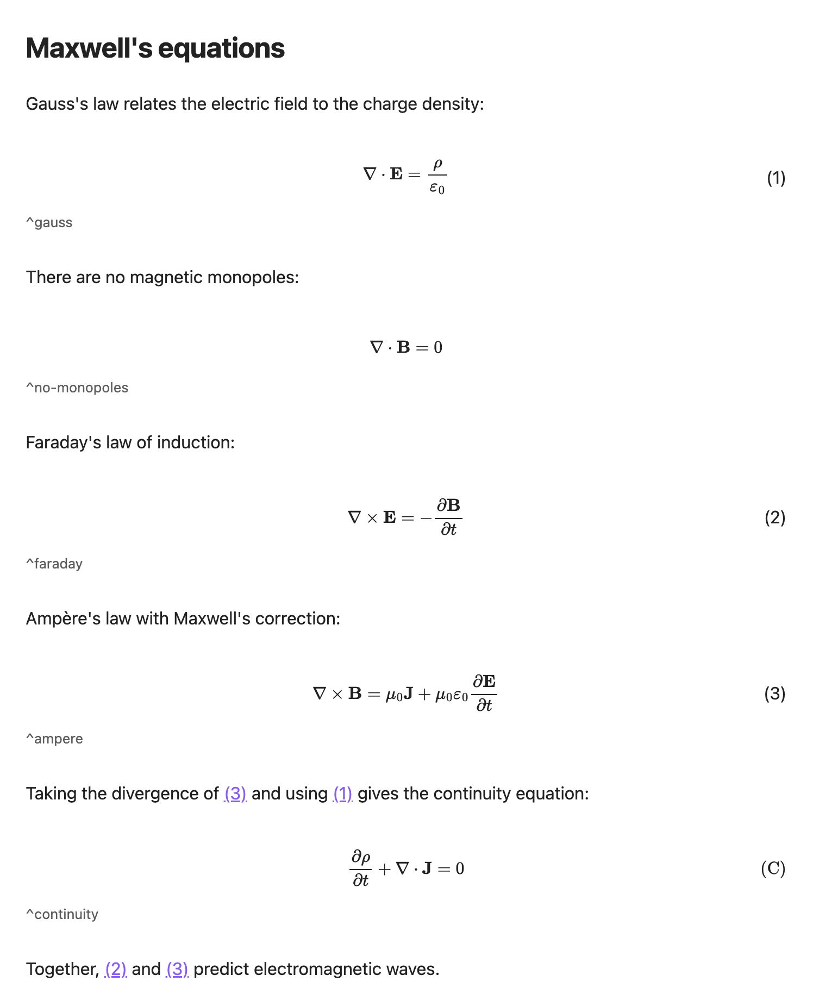

# Equation Refs

[](https://github.com/dingzy53/obsidian-equation-refs/releases/latest)
[](https://community.obsidian.md/plugins/equation-refs)
[](https://obsidian.md)
[](LICENSE)

Number display equations in [Obsidian](https://obsidian.md) **only when you link to them**, and show the links as the numbers, like LaTeX's `\eqref`.



## Features

- Works in Reading view, Live Preview, embeds and PDF export.
- Uses Obsidian's own block links (`[[note#^label]]`). No new syntax, and your notes are never modified.
- Zero runtime dependencies. You don't need MathLinks or any other plugin.
- Numbers are drawn with CSS, so MathJax doesn't re-render as you type or scroll.

## Requirements

- Obsidian 1.13.0 or newer, on desktop or mobile.

## Installation

**From the community directory** (recommended)

1. Open **Settings → Community plugins** and turn on community plugins if asked.
2. Select **Browse**, search for **Equation Refs**, then select **Install** and **Enable**.

You can also open the plugin's page: [community.obsidian.md/plugins/equation-refs](https://community.obsidian.md/plugins/equation-refs).

**Manually**

1. Download `main.js`, `manifest.json` and `styles.css` from the [latest release](https://github.com/dingzy53/obsidian-equation-refs/releases/latest).
2. In **Settings → Community plugins**, select the folder icon next to **Installed plugins**. This opens `<vault>/.obsidian/plugins/`.
3. Create a folder named `equation-refs` there and put the three files in it.
4. Select the reload icon next to **Installed plugins**, then enable **Equation Refs**.

**Beta versions:** install [BRAT](https://github.com/TfTHacker/obsidian42-brat) and add `dingzy53/obsidian-equation-refs`.

**Update or remove:** select **Check for updates** or **Uninstall** in **Settings → Community plugins**.

## Usage

Give a display equation a block ID, then link to it:

```md
$$
\nabla \cdot \mathbf{E} = \frac{\rho}{\varepsilon_0}
$$
^gauss

By [[#^gauss]], …                      → By (1), …
See [[Maxwell#^gauss]] for details.    → See Maxwell (1) for details.
See [[Maxwell#^gauss|Gauss's law]].    → aliased links are left unchanged
```

You don't have to type the ID yourself. Type `[[Maxwell#^`, and Obsidian's link suggestions list the note's blocks and create the `^id` for you.

In Live Preview, a reference shows its number until you move the cursor into it. Then it shows the raw link so you can edit it. Click a reference to open it, and Ctrl/Cmd-hover to preview it.

## Numbering rules

- An equation gets a number only if at least one link anywhere in the vault points to it. A link from the same note counts. Embeds (`![[…]]`) don't count, because they aren't references.
- Numbers are 1, 2, 3, … in document order, counting only numbered equations. The count restarts in each note.
- `\tag{x}` is respected. References show `(x)`, and the equation doesn't use up a number.
- `\notag` or `\nonumber` keeps an equation unnumbered even if it is linked.
- Adding or removing a link anywhere updates the numbers in open notes automatically.

## Settings

| Setting | Default | Placeholders |
|---|---|---|
| Same-note reference format | `({n})` | `{n}` is the number |
| Other-note reference format | `{note} ({n})` | `{n}` is the number, `{note}` is the note name |

Example: set the other-note format to `{note}, eq. ({n})` to get `Maxwell, eq. (1)`.

## Styling

Override these CSS variables in a snippet:

```css
body {
	--eqref-number-font: var(--font-text);
	--eqref-number-color: var(--text-normal);
	--eqref-number-size: var(--font-text-size);
	--eqref-number-gutter: 3em; /* space kept free on both sides of a numbered equation */
}
```

Numbered equations have the class `eqref-numbered`, and the number is in their `data-eq-number` attribute. Formatted links have the class `eqref-link`.

## Privacy and security

- No network access, and no files outside the vault.
- Notes are only read, never changed: numbers exist only on screen and in exported PDFs.

## Limitations

- Only top-level `$$` blocks are numbered. Equations inside callouts, block quotes or lists aren't.
- Each `$$` block gets one number. There's no per-line numbering in `align`; use `\tag{}` by hand if you need it.
- Numbers restart in each note. There are no chapter prefixes.
- Links in Canvas files aren't counted.

## Similar plugins

[Equation Citator](https://github.com/FRIEDparrot/obsidian-equation-citator), [Latex Equation References](https://github.com/GeorgRasumov/Obsidian-Latex-Equation-References), [Auto Equation Numbering](https://github.com/Wolframscs/obsidian-Auto-Equation-Numbering) and [Equation Ordinal](https://github.com/Junzi-ana/equation-ordinal) use LaTeX-style `\label`/`\ref` syntax or write numbers into your files. Equation Refs instead uses Obsidian's native block links, numbers only the equations you link to, and never edits your notes.

## Development

```sh
npm install
npm run dev     # rebuild main.js on change
npm run build   # type-check and production build
npm run lint    # eslint with eslint-plugin-obsidianmd (the rules the community review uses)
npm test        # unit tests for src/core
```

`test-vault/` has example notes. Open it as a vault and link the build output into `test-vault/.obsidian/plugins/equation-refs/`. See [PLAN.md](PLAN.md) for the design.

## Credits

Inspired by [LaTeX-like Theorem & Equation Referencer](https://github.com/RyotaUshio/obsidian-latex-theorem-equation-referencer) (formerly Math Booster) by Ryota Ushio, released under the MIT License. Equation Refs reimplements only its equation-numbering and referencing idea, from scratch. Thank you for the original work.

## License

[MIT](LICENSE) © 2026 Ding Zheng Yuan
